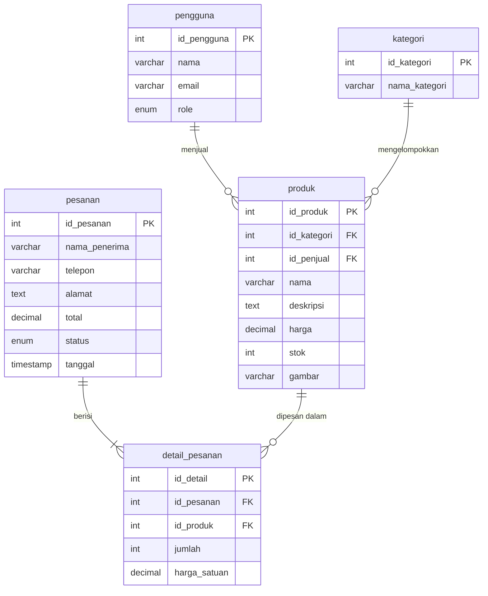
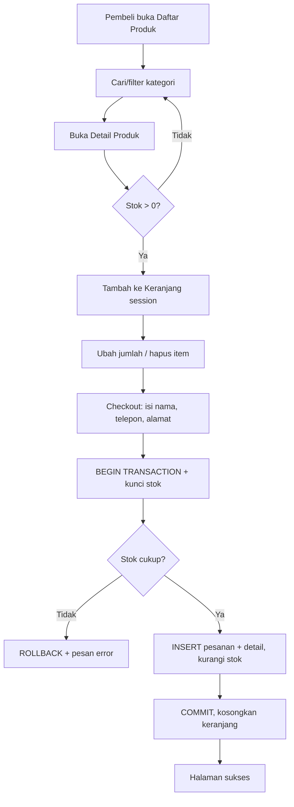

# Dokumen Perancangan Marketplace Tradisional (Soal 11 & 12)

## SOAL 11-A. Analisis dan Perancangan

### a. Entitas
1. **pengguna** – penjual/pembeli
2. **kategori** – pengelompokan produk
3. **produk** – barang yang dijual
4. **pesanan** – header transaksi
5. **detail_pesanan** – item per pesanan
(Keranjang disimpan di `$_SESSION` karena bersifat sementara.)

### b. Rancangan Tabel
| Tabel | Atribut (PK **bold**, FK *italic*) |
|---|---|
| pengguna | **id_pengguna**, nama, email (unique), role |
| kategori | **id_kategori**, nama_kategori (unique) |
| produk | **id_produk**, *id_kategori*, *id_penjual*, nama, deskripsi, harga, stok, gambar |
| pesanan | **id_pesanan**, nama_penerima, telepon, alamat, total, status, tanggal |
| detail_pesanan | **id_detail**, *id_pesanan*, *id_produk*, jumlah, harga_satuan |

Relasi: kategori 1–N produk; pengguna(penjual) 1–N produk; pesanan 1–N detail_pesanan; produk 1–N detail_pesanan (pesanan–produk = M:N lewat detail_pesanan).

### c. ERD

(Render di GitHub otomatis, atau tempel ke https://mermaid.live lalu screenshot.)

### d. Alur Transaksi


### e. Mockup UI (wireframe)
**Daftar Produk (index.php)**
```
+--------------------------------------------------+
| Pasar Tradisional            Keranjang(2)  Admin |
+--------------------------------------------------+
| [ Cari produk...        ] [Kategori v] [Cari]    |
| +--------+ +--------+ +--------+ +--------+      |
| | gambar | | gambar | | gambar | | gambar |      |
| | Bayam  | | Pisang | | Cabai  | | Bawang |      |
| | Rp3.000| |Rp15.000| |Rp12.000| |Rp18.000|      |
| |[Detail]| |[Detail]| |[Detail]| |[Detail]|      |
+--------------------------------------------------+
```
**Detail Produk (produk_detail.php)**
```
+--------------------------------------------------+
| +----------+  Pisang Kepok 1 Sisir   [Buah]      |
| |  gambar  |  Rp 15.000                          |
| |          |  Deskripsi ...                      |
| +----------+  Penjual: Toko Bu Sari | Stok: 30   |
|               [ jumlah: 1 ] [+ Keranjang]        |
+--------------------------------------------------+
```
**Keranjang (keranjang.php)**
```
+--------------------------------------------------+
| Produk        Harga    Jumlah   Subtotal          |
| Bayam         3.000    [ 2 ]    6.000   [Hapus]   |
| Pisang       15.000    [ 1 ]   15.000   [Hapus]   |
|                          Total: Rp 21.000         |
| [Perbarui]                       [Checkout]       |
+--------------------------------------------------+
```

## SOAL 12-A. Analisis dan Perancangan API

### a. Fungsi Web Service/API
API adalah antarmuka yang membuat sistem lain dapat membaca/menulis data marketplace lewat HTTP dengan format standar (JSON), tanpa mengakses database atau HTML aplikasi secara langsung. API diperlukan karena: (1) aplikasi mobile/pihak ketiga memakai teknologi berbeda dari PHP, JSON bersifat independen platform; (2) logika bisnis (validasi stok, hitung total) terpusat di satu tempat; (3) database tetap aman karena tidak dibuka ke luar; (4) satu backend dapat melayani banyak klien (web, Android, iOS, marketplace lain).

### b. Rancangan Endpoint
| No | Endpoint | Fungsi | Kode status |
|---|---|---|---|
| 1 | GET /api/produk.php | Seluruh produk | 200 |
| 2 | GET /api/produk.php?id=1 | Detail produk | 200, 400, 404 |
| 3 | GET /api/kategori.php | Daftar kategori | 200 |
| 4 | POST /api/pesanan.php | Buat pesanan baru | 201, 400, 404, 409, 422 |
| 5 | GET /api/pesanan.php?id=1 | Detail pesanan | 200, 400, 404 |

### c. Struktur JSON
Daftar produk:
```json
{"status":"success","total":2,"data":[
 {"id_produk":1,"nama":"Bayam Segar 1 Ikat","deskripsi":"...","harga":3000,"stok":50,"gambar":null,"id_kategori":1,"nama_kategori":"Sayuran"},
 {"id_produk":2,"nama":"Pisang Kepok 1 Sisir","deskripsi":"...","harga":15000,"stok":30,"gambar":null,"id_kategori":2,"nama_kategori":"Buah"}]}
```
Detail produk:
```json
{"status":"success","data":{"id_produk":1,"nama":"Bayam Segar 1 Ikat","harga":3000,"stok":50,"nama_kategori":"Sayuran"}}
```
Body POST /api/pesanan.php:
```json
{"nama_penerima":"Andi","telepon":"08123456789","alamat":"Jl. Merdeka 1, Pekanbaru","items":[{"id_produk":1,"jumlah":2},{"id_produk":3,"jumlah":1}]}
```
Error: `{"status":"error","message":"Produk dengan id 99 tidak ditemukan"}`

## Cara Menjalankan di XAMPP
1. Salin folder `marketplace` ke `C:\xampp\htdocs\`.
2. Start Apache & MySQL, buka http://localhost/phpmyadmin → Import `database.sql`.
3. Pastikan `config.local.php` sesuai (default XAMPP: user root, password kosong).
4. Web: http://localhost/marketplace/ — Admin: http://localhost/marketplace/admin/produk.php
5. API: http://localhost/marketplace/api/produk.php

## Pengujian Postman
| # | Request | Hasil diharapkan |
|---|---|---|
| 1 | GET /api/produk.php | 200, daftar produk |
| 2 | GET /api/produk.php?id=1 | 200, detail |
| 3 | GET /api/produk.php?id=999 | 404 |
| 4 | GET /api/kategori.php | 200 |
| 5 | POST /api/pesanan.php (body JSON di atas, Content-Type: application/json) | 201 + id_pesanan |
| 6 | POST dengan jumlah melebihi stok | 409 |
| 7 | GET /api/pesanan.php?id=<id dari #5> | 200 + items |
Setelah #5, cek di phpMyAdmin tabel `pesanan`, `detail_pesanan`, dan kolom `stok` berkurang.

## Deployment InfinityFree (Soal 11-h)
1. Daftar → Create Account (hosting gratis) → catat subdomain (mis. `namamu.infinityfreeapp.com`).
2. Control Panel → MySQL Databases → buat database; catat host (sqlXXX.infinityfree.com), username, password, nama DB.
3. phpMyAdmin → pilih DB → Import `database.sql`, **hapus dahulu baris `CREATE DATABASE` dan `USE marketplace;`** (di InfinityFree nama DB sudah ditentukan).
4. File Manager / FTP → unggah isi folder ke `htdocs/`, lalu buat `config.local.php` di server dengan kredensial hosting dan password admin yang kuat.
5. Uji di URL subdomain.

## GitHub
```
git init
git add .
git commit -m "Marketplace PHP Native + REST API"
git branch -M main
git remote add origin https://github.com/USERNAME/marketplace.git
git push -u origin main
```
`config.local.php` sudah ada di `.gitignore` (hanya `config.sample.php` yang ter-upload). Cek dengan `git status` sebelum commit.

## Template Laporan (isi sendiri)
- URL demo: https://........infinityfreeapp.com
- URL GitHub: https://github.com/USERNAME/marketplace
- Screenshot: daftar produk, detail, keranjang, checkout sukses, admin CRUD
- Screenshot: struktur DB (phpMyAdmin → Designer) dan isi tabel pesanan/detail_pesanan
- Screenshot: Postman (request + response) dan browser localhost
